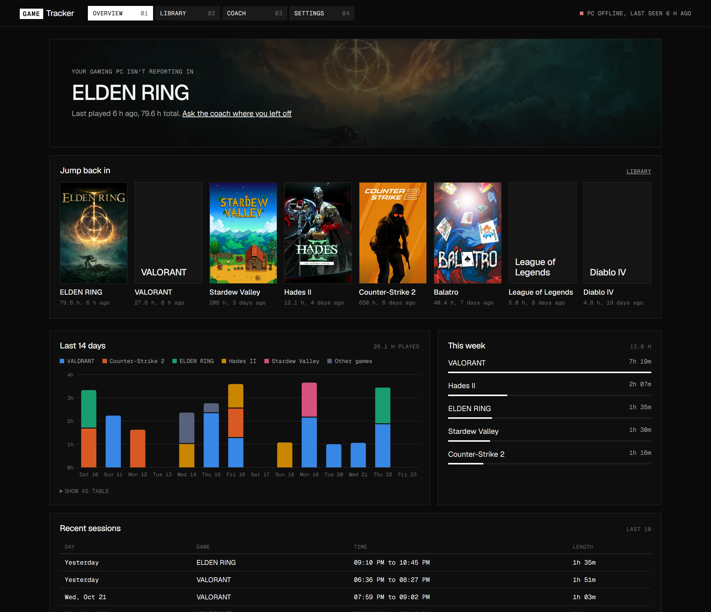
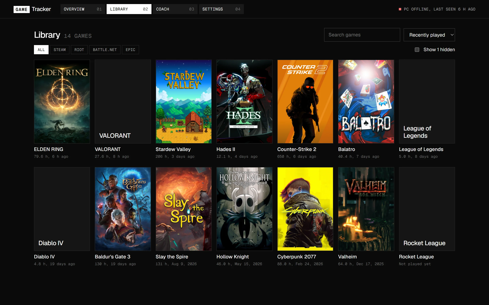
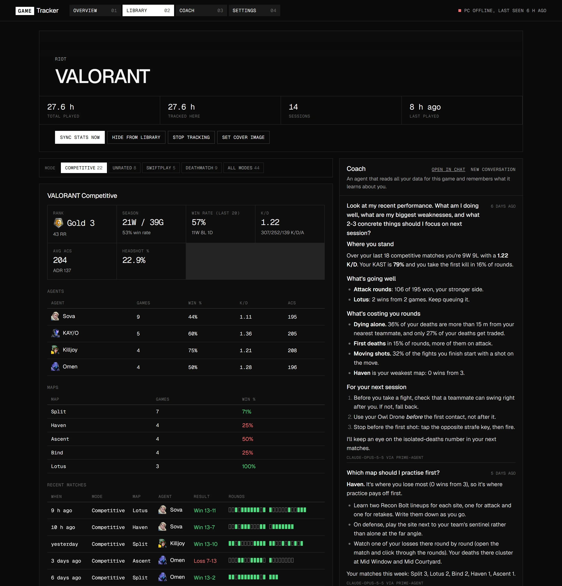
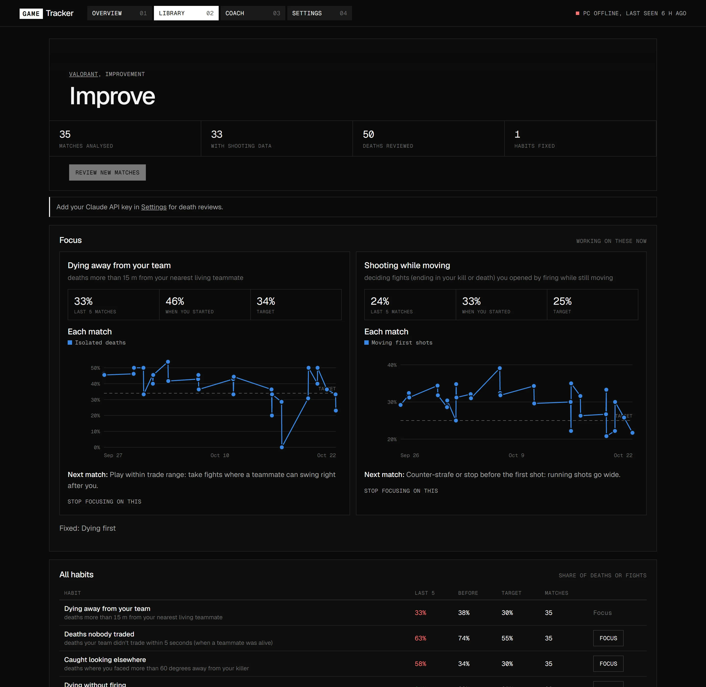

# Game Tracker

A personal, self-hosted game tracker with a Claude coach. It:

- **Finds your installed games**: Steam (all library folders), Riot (VALORANT, League, TFT), Epic, Battle.net, EA, Ubisoft, GOG and Xbox/Game Pass, with cover art from the stores.
- **Notices what you're playing** by watching running processes, and records each session.
- **Imports your history**: Steam's own playtime and last-played dates come in on the first scan.
- **Tracks stats where they exist**:
  - VALORANT: rank and RR, every act's record, and for each match K/D/A, ACS, ADR, HS%, the full scoreboard, the economy and every round (buys, kill feed, where you killed and died on the minimap).
  - Counter-Strike 2: lifetime stats from Steam, live per-round tracking through Valve's Game State Integration, and round maps from the demos you download.
  - League of Legends: ranked queues, matches and champions, plus live KDA/CS while you're in a game.
  - Overwatch: role ranks, career stats per hero (with a page per hero), a per-session breakdown, and rank history.
  - Steam achievements for any Steam game, with unlock dates and global rarity.
- **Helps you improve** in VALORANT and CS2: habit stats from every death, a Claude review of each death, and one or two focus habits at a time, tracked match by match.
- **Has a Claude coach** on every game and match page, and a chat page with your full conversation history. For story games it works out where you are from your achievements, playtime and notes, then suggests what to do next, with spoiler control. For competitive games it reads your matches and tells you what to work on.
- **Keeps a guides knowledge base** per game: it finds YouTube guides that fit you, and Claude boils each one down into short notes with links to the exact moment.

The tracker part is Windows only. The server and dashboard run anywhere Python does.

## Screenshots

All from the demo (made-up data, see below).

| | |
|---|---|
|  |  |
|  |  |

## Try the demo

```bash
pip install -r requirements.txt
python -m gametracker demo
```

This opens the dashboard at <http://localhost:8788> with a made-up library, five weeks of play sessions, VALORANT, CS2 and League matches, death reviews and a few coach conversations. Every name and number is invented.

The demo runs the server only. It doesn't scan your PC or start the tracker, and the server makes no internet requests (your browser still loads cover art from Steam's image servers and agent icons from valorant-api.com). Its data goes to a temp folder that's deleted when you stop it with Ctrl+C. Set `GAMETRACKER_DATA` to keep it somewhere else; the demo refuses a folder that already holds other data. API keys in your environment are ignored, so the coach says it isn't set up.

## Quick start (everything on your gaming PC)

1. Double-click **`start.bat`**. The first run sets up Python packages in `%LOCALAPPDATA%\GameTracker\venv` and then opens the dashboard at <http://localhost:8787>.
2. Open **Settings** and fill in what you want to use:
   - **Claude API key**: create one at <https://console.anthropic.com> (Settings > API keys). Paste it into the dashboard, not into a chat. You can also set the `ANTHROPIC_API_KEY` environment variable instead. If you don't have prime-agent (see [Coach engine](#coach-engine)), set **Coach engine** to **Claude API directly**.
   - **Overwatch BattleTag** (`Name#1234`). In Overwatch, set Options > Social > Career Profile Visibility to **Public**.
   - **YouTube API key** for the guides knowledge base (optional).
3. Play something. The Overview page shows a live session timer, and stats sync on their own when you finish.

Requires Python 3.10+ on Windows. The tracker reads the process list, launcher files and the game clients' local APIs. It never touches game memory or sends input to a game, so anti-cheat isn't involved.

## Run the server on a home server (Tailscale)

The tracker has two parts:

| Part | Runs on | Does |
|---|---|---|
| **agent** | your Windows gaming PC (it must) | scans launchers, watches processes, reads the Riot and League clients, Steam's local files, CS2's game state and demos, and (if they're on) your game inputs and NVIDIA App recordings, then reports to the server |
| **server** | anywhere: the PC itself, or your home server | database, dashboard, Claude coach, death reviews, guides knowledge base |

`start.bat` with no arguments runs both on the PC. To move the server to your home server:

**On the home server** (Docker):

```bash
docker compose up -d --build
tailscale serve --bg 8787
```

`tailscale serve` publishes the dashboard on your tailnet with HTTPS at `https://<server-name>.<your-tailnet>.ts.net`. Only your tailnet devices can reach it, and the container itself only listens on the server's loopback. Put your timezone in a `.env` file next to `docker-compose.yml` (for example `TZ=Europe/Berlin`), so "today" and session days line up. It defaults to UTC.

Without Docker it's the same Python package: `pip install -r requirements.txt`, then `python -m gametracker server` (it binds to 127.0.0.1 by default), then `tailscale serve --bg 8787`.

**On the gaming PC:** open the server's dashboard, go to Settings > *Run the server elsewhere* > **Show agent command**, and run what it shows:

```bat
start.bat agent --server https://homeserver.your-tailnet.ts.net --token <agent token>
```

The server URL and token are saved, so after that `start.bat agent` is enough. If the server is unreachable, the agent keeps sessions and stats in `data\agent_outbox.json` and sends them once it reconnects.

### Start with Windows

Press Win+R, type `shell:startup`, and put a shortcut there to:

- `start-hidden.vbs` to run everything on this PC, or
- `start-hidden.vbs agent` to run only the tracker, reporting to your home server.

It runs with no window and logs to `data\gametracker.log`.

## The improvement loop (VALORANT and CS2)

After each match syncs, the server works out what happened at every one of your deaths, straight from the match data: who was alive, how far your nearest teammate and your killer were, which way you were facing, whether a teammate traded you, and how soon after your own kill you died. For CS2 this needs a downloaded demo (Watch > Your Matches); live-tracked CS2 matches have no positions.

- **Habits.** Eight habits are measured per match: dying away from your team, deaths nobody traded, getting caught looking elsewhere, dying without firing, shooting while moving, holding the trigger too long, re-peeking after a kill, and dying first. Each has a target.
- **Death reviews.** Claude (Haiku by default, a fraction of a cent per match) reviews every death of a new match in one call: which habits it shows, a one-line verdict and a one-line fix. Mark a review **Not fair** and later reviews are told to avoid the same over-call.
- **Focus habits.** You work on one or two habits at a time. The tracker picks them when the data clearly shows a problem, or you choose them. A habit counts as fixed once three matches in a row are at or under its target.

Two optional sources make the facts richer:

- **Your key presses** (on by default, see [Privacy](#privacy)). In VALORANT, lining your trigger pulls up with your kills gives the match clock. Then the tracker knows whether you fired in the last two seconds before a death, whether your last shot was on the move, and how you opened each fight. It also times your abilities from your C, Q, E and X presses (default binds), checks the count against Riot's own cast counts, and shows when you used each one every round, and whether you died before using any. CS2 gets its shooting facts from the demo instead.
- **Video evidence through the NVIDIA App** (off by default). The NVIDIA App records each VALORANT match and saves an Instant Replay when you die in CS2. The PC cuts six small frames from the last five seconds before each death (the crosshair area, the minimap and the kill feed). For VALORANT it also crops the game's combat report from the next round's buy phase: who killed you and the damage you dealt and took per enemy. Then it deletes the video and sends the frames to the server. Claude looks at them in the death reviews. They only add what the data can't show, like crosshair placement and how you peeked. The tracker talks to the NVIDIA App through its local server on 127.0.0.1, which needs the In-Game Overlay on.

## Guides knowledge base

For each game you've played in the last three weeks, once a week (or when you press **Find new guides**), the server:

1. asks Claude which YouTube searches would help you most, based on your stats or story progress,
2. searches YouTube with your YouTube API key and picks a few guides,
3. downloads their English captions, and
4. has Claude write short notes in its own words, each with a link to the moment in the video.

Only the notes and links are kept, never the transcripts. You can also paste a video link to add one guide. YouTube blocks caption downloads from most servers, so the gaming PC downloads them when it's online: at most 40 a day, a few seconds apart, and none for a day after YouTube refuses one. The coach reads the notes, and with prime-agent it can save, fix or remove notes too.

## Coach engine

The coach answers on each game page, on each match page, and on the **Coach** page, which keeps every conversation (grouped by date, searchable, with rename and delete). Each game has a current conversation; **New conversation** starts another, and each match gets its own. A conversation about **All games** covers your whole library.

By default the coach is a **prime-agent** running in its own Docker container (the `coach` service), using your Claude API key. It has continual learning and history:

- **Own home folder.** prime-agent keeps its sessions, harness memory and Python kernel in `data/coach-home`.
  This is separate from any prime-agent setup on the host; your `~/.prime` is never mounted.
- **Full data.** Before every question the tracker writes a read-only snapshot of its database to
  `data/snapshot/gametracker.db`. That shows up in the agent's workspace as `data/gametracker.db`, and the
  workspace `AGENTS.md` explains the schema, so the agent can query any match, round or session. It never sees
  `config.json`. The death frames are mounted read-only too.
- **Tools.** It can search the web (when **Let the coach search the web** is on), read web pages, and save, fix or
  remove notes in the guides knowledge base.
- **Conversations.** Each conversation resumes the same prime-agent session. The agent's long-term memory of you
  carries over between conversations.

Setup: point `PRIME_AGENT_DIR` at your prime-agent install in `.env` next to `docker-compose.yml`:

```
PRIME_AGENT_DIR=/home/<you>/.local/share/prime-agent
```

The program is mounted read-only. Without Docker the server runs prime-agent itself, from `PRIME_AGENT_BIN` or your `PATH`.

**Settings > Coach engine > Claude API directly** needs nothing but the API key. That mode has no memory between
conversations and can't query the database (it gets the same summary of your data with each question), but it can use
Claude's server-side web search.

## Where the numbers come from

| Game | Source | Notes |
|---|---|---|
| VALORANT | The Riot Client on your PC (your own login), which reads Riot's match-history, MMR and name services. Names of maps, agents and ranks from [valorant-api.com](https://valorant-api.com) | **Unofficial** endpoints the game client itself uses, so they can break after any patch. Syncs while the client or game is open (every 10 min while playing, and after each session). Riot keeps your last 25 matches in full. |
| League of Legends | League client local API (LCU), plus the in-game Live Client Data API | The LCU is **unofficial** and can change with patches. Needs the League client open to sync. |
| Counter-Strike 2 | Steam's local stats cache (lifetime), Valve's Game State Integration (live rounds), and your downloaded demos, read with [demoparser2](https://github.com/LaihoE/demoparser) | The agent writes a GSI config file into CS2's `cfg` folder once (CS2 reads it at launch) and listens on 127.0.0.1. GSI never shows positions; demos do. Radar images and map coordinates come from [awpy-data](https://github.com/pnxenopoulos/awpy-data). |
| Overwatch | [OverFast API](https://overfast-api.tekrop.fr), a community API over Blizzard's public career profiles | Profile must be public. Blizzard updates profiles with a delay, so session breakdowns can take ~30 min to show up. |
| Steam games | Steam's local achievement cache (`appcache/stats`), plus global unlock rates from the Steam Web API (no key needed) | A Steam Web API key is optional. It's only used when a game has no local cache. |
| Everything else | Playtime and sessions, plus your notes for the coach | Add stat sources in `gametracker/integrations/`. |

## Privacy

Everything is stored in `data/` next to the code (or in `GAMETRACKER_DATA`): the SQLite database, `config.json` (which includes any keys you enter), the coach's folders and, on the gaming PC, the agent's own files.

### Key presses and mouse

While **Read my movement and shooting** is on (Settings > Improvement reviews; it's on by default), the agent records some of your input, and only while VALORANT or CS2 is the window in front:

- these keys going down and up: W, A, S, D, Ctrl, Shift, Space, C, Q, E, X and 1 to 4;
- the left and right mouse buttons going down and up;
- mouse movement, added up every 25 ms;
- when that game gains or loses focus.

Each entry has a millisecond timestamp. No other key is recorded, so nothing you type can be read back, and nothing at all is recorded while another window is in front. It uses Windows Raw Input in passive mode on an invisible window: nothing is hooked or injected, and no input is ever sent anywhere.

The logs stay on the gaming PC, in `data\inputs\` (one file per hour), and are deleted after 14 days. They never leave the PC. Only small summaries go with each VALORANT match to the server: the clock offset, counts of how you opened fights, whether you fired and moved before each death, and your ability cast times per round. Those summaries reach Claude in death reviews and coach answers. Turn the setting off and nothing is recorded.

### Video

Video evidence is off until you turn it on. Then the NVIDIA App records VALORANT matches and saves CS2 Instant Replays into its own video folder. The PC cuts six frames per death (plus the combat report in VALORANT) and deletes the video (and any recording no match claims within 12 hours). Only the frames go to the server, which keeps them in `data/frames` for 120 days.

### What leaves your machines

- **Anthropic (Claude API)**, with your key:
  - when you ask the coach: that game's playtime, sessions, achievements, stats, matches, habit stats, death reviews, guide notes and your notes. With prime-agent, the agent can also query the database snapshot and look at death frames, and the answer can include web searches and pages it reads;
  - after each VALORANT or CS2 match, if death reviews are on: the facts about each death, and its frames if video evidence is on;
  - for the guides knowledge base: a summary of your data for that game, and the captions of each guide it reads.
- **YouTube**: the guide searches Claude chose (with your YouTube API key), and caption downloads from the PC or the server.
- **Riot**: the agent calls Riot's game servers with your own login, the same calls the game client makes, including the name service for the other players in your matches.
- **OverFast**: receives your BattleTag.
- **Steam, the Microsoft Store and valorant-api.com**: asked for public data. Cover-art lookups send your games' names or Steam app ids. Steam is also asked for achievement rarity and, with a Steam Web API key, for your achievements by Steam ID.
- **GitHub**: CS2 radar images and map data come from the awpy-data releases.
- **Your browser** loads the dashboard's fonts from Google Fonts and images from the stores' and valorant-api.com's image servers.
- **Between your machines**: the agent sends the server your PC's hostname, the games it found (with install folders), your sessions and stats, death frames and guide captions. With Tailscale that traffic stays on your tailnet.

The agent talks to the server with a shared token. Dashboard write requests need a custom header, and unknown hostnames are rejected, so other websites can't drive it from your browser. In Docker the coach container only sees its own folders and, read-only, the database snapshot and the death frames. Without Docker, prime-agent runs as an ordinary process under your account.

## Command line

```text
python -m gametracker                     server + agent on this PC (what start.bat runs)
python -m gametracker server [--host H]   server only
python -m gametracker agent --server URL --token T
python -m gametracker scan                list detected games
python -m gametracker token               print the agent token
python -m gametracker demo                the dashboard with made-up data (port 8788, throwaway folder)
python -m gametracker coach-runner        the prime-agent coach service (what the coach container runs)
  --port N  --no-browser  --log FILE
```

`GAMETRACKER_DATA` overrides the data folder.

## Layout

```text
gametracker/
  __main__.py       command line
  config.py         settings in data/config.json (keys can come from the environment)
  db.py             SQLite schema and queries
  server.py         HTTP server: dashboard API + agent API
  agent.py          PC side: scan, track, sync, report (with offline outbox)
  detect.py         launcher scanners (Steam, Riot, Epic, Battle.net/EA/Ubisoft, GOG, Xbox)
  tracker.py        process matching -> sessions
  vdf.py            Valve KeyValues files (text and binary)
  net.py            HTTP helpers and a cache for static game data
  art.py            cover and hero art (Steam, Epic, Microsoft Store)
  integrations/     valorant, league, overwatch, cs2, achievements (Steam)
  cs2_demo.py       CS2 demos -> match records with positions
  radar.py          CS2 radar images
  inputs.py         key and mouse reading for VALORANT and CS2, and reading the logs back
  capture.py        video evidence through the NVIDIA App
  improve.py        habit stats, Claude death reviews, focus habits
  kb.py             guides knowledge base (YouTube search, Claude notes)
  captions.py       YouTube captions, paced on the PC
  coach.py          Claude coach: context, presets, spoiler levels, conversations
  coach_runner.py   prime-agent runner (the coach container)
  coach_tools.py    tools the coach agent gets in its workspace
  demo.py           demo mode
  web/              dashboard (vanilla HTML/CSS/JS)
docs/               screenshots
Dockerfile, docker-compose.yml   server and coach containers
start.bat, start-hidden.vbs      Windows launchers
```

## License

MIT. See [LICENSE](LICENSE).
